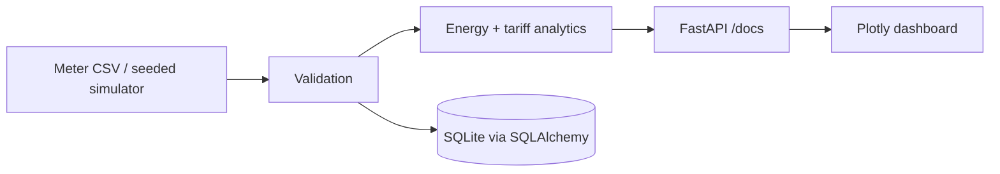

# Smart Energy Management System

Meter data validation, consumption analytics, tariff cost estimation, anomaly screening, REST API, and a browser dashboard for energy use.

## Problem and objectives

Interval meters produce data that must be validated before aggregation. This project converts voltage, current, real power, and power factor readings into energy and cost summaries while keeping simulated values clearly labeled.

## Features

- CSV ingestion with timestamp, numeric, physical-range, duplicate, and finite-value validation.
- Deterministic 15-minute synthetic meter readings, explicitly tagged as simulated.
- Trapezoidal integration of power in W over elapsed time to kWh.
- Configurable linear EUR/kWh tariff and fixed fee.
- Population z-score anomaly flags and hourly/daily/weekly/monthly kWh aggregates.
- FastAPI endpoints, SQLAlchemy/SQLite persistence, OpenAPI docs at `/docs`.
- Plotly dashboard at `/` with energy, estimated cost, peak load, anomaly count, and hourly chart.

## Architecture



`energy_manager.core` contains validation and analytics. `api` exposes ingestion and summaries; the browser dashboard consumes the analytics endpoint. The API uses a local SQLite file and is intended for a single-user demonstration, not a utility control system.

## Engineering decisions

For adjacent samples, energy is estimated as `((P[i-1] + P[i]) / 2) * delta_t / 3,600,000` kWh. Trapezoidal integration accommodates irregular sample intervals. Cost is `energy_kWh * tariff + base_fee`. The anomaly screen uses a configurable absolute population z-score; it is a simple demonstration and can miss distribution shifts or be sensitive to skewed loads. Power factor is constrained to `[0,1]`; the project does not infer real power from voltage/current because phase and meter wiring are unknown.

## Installation

Windows PowerShell:

```powershell
py -3.11 -m venv .venv
.\.venv\Scripts\python.exe -m pip install -e ".[test]"
```

Linux/macOS:

```sh
python3 -m venv .venv
. .venv/bin/activate
python -m pip install -e '.[test]'
```

## Usage

```powershell
energy --generate examples/generated.csv --tariff 0.32
energy --csv examples/meter_sample.csv --tariff 0.30
uvicorn energy_manager.api:app --reload
```

Open `http://127.0.0.1:8000/` for the dashboard and `/docs` for the REST schema. `POST /readings` accepts a JSON array with `timestamp`, `voltage_v`, `current_a`, `power_w`, and `power_factor`; `GET /analytics?tariff_eur_per_kwh=0.30` returns analytics. The dashboard requires internet access to load Plotly from its pinned CDN. Example CSV rows are illustrative; generated rows are synthetic and are not physical meter data.

## Tests

Run `python scripts/run_tests.py` from an uninstalled checkout, or `python -m unittest discover -s tests -v` after installation. Six tests passed locally; two API integration tests were skipped because FastAPI and SQLAlchemy are unavailable in the machine environment.

## Limitations and next steps

The tariff is flat-rate; taxes, time-of-use windows, demand charges, reactive energy, daylight-saving billing, and meter calibration are outside scope. SQLite defaults to `energy.db` in the working directory. Future work could add tariff schedules, authenticated multi-user ingestion, migrations, and real meter adapters after protocol and electrical safety review.

All generated readings are simulations. No smart meter, mains circuit, or electrical installation has been connected or tested.
